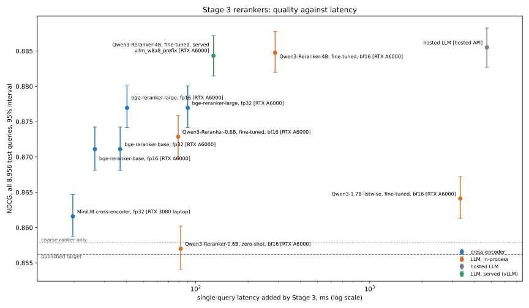

# Results — Multimodal Product Re-Ranking on Amazon ESCI (Task 1)

Every measured figure below is quoted from a committed file under
`docs/results/`, named beside it. The only exceptions are the published
baselines, cited from the papers listed under References and marked as
published.
`tests/test_results_doc.py` checks every four-decimal figure in this file
against those sources. "Plan N" names the development step that measured a
result.

## 1. What this is

A multi-stage re-ranker for ESCI Task 1 (English), the query–product ranking
task of the Amazon Shopping Queries Dataset: a LightGBM LambdaMART coarse
ranker over 47 features, fine re-ranking of its top 10 by a fine-tuned
cross-encoder, a fine-tuned open LLM served on one GPU, or a hosted LLM
listwise call, and a blend stage. ESCI is enriched with images, prices,
ratings, categories and attributes from the ESCI-S scrape.

The task is **re-ranking**: each query's judged candidates are the input, so
ranking is scored as full-list NDCG over each query's judged list (gains
E 1.0, S 0.1, C 0.01, I 0.0). Every NDCG sits beside a random floor computed
on the same queries, with a 95% bootstrap interval over queries.

An earlier version also had LLM query rewriting and a recall stage over the
1.2M-product catalogue. Retrieval is not part of any ESCI task, so it was
removed; its code and results live at the `v1-with-retrieval` tag.

## 2. Headline

**The two best rankers tie: a hosted LLM's listwise re-ranking of the coarse
ranker's top 10, NDCG 0.8855 [0.8827, 0.8883] over all 8,956 queries of the
test split, and a fine-tuned open `Qwen3-Reranker-4B` served on one GPU**
(below). The hosted arm stands against a random floor of 0.7468 and the
coarse ranker's own 0.8579 — a gain of +0.0276 [+0.0255, +0.0296]
(`fine-rank-test-full.json`).

That interval lies entirely above the **0.8562 `ESCI_baseline`** (a
cross-encoder fine-tuned on the train split, published by Al Ghossein et al.),
the target this project set itself, and it is measured on the same 8,956
queries. **The pipeline beats the published baseline.** For the hosted arm
the caveat is cost: the baseline is one cross-encoder pass, while this ends in
an API call that takes 4.7 s for a single query.

The LLM arm was first measured on a frozen random sample of 2,000 test
queries, because each query is a paid call: 0.8855 [0.8799, 0.8910]
(`fine-rank-test.json`). The whole split was then run once, with the
configuration unchanged. The point estimate did not move, and the interval
halved.

Without the LLM, the coarse LambdaMART ranker alone scores **0.8579 [0.8551,
0.8611]** (`coarse-rank-test.json`). Its interval contains 0.8562, so it
**matches** the target rather than beating it. Re-ranking its top 10 with a
larger fine-tuned cross-encoder, `bge-reranker-large` trained on every judged
pair, reaches **0.8770 [0.8742, 0.8801]** with no API call at all
(`size-test.json`, Section 8). That arm was chosen on fold 0 before the test
split was scored. It also lies wholly above the target, at 205.2 ms a query on
the laptop's RTX 3080.
The next size down, `bge-reranker-base` under the same recipe, scores 0.8711
[0.8681, 0.8742] at 64.5 ms (`capacity-test.json`), so the larger model buys
+0.0059 [+0.0044, +0.0074] for about three times the latency.

**A fine-tuned open LLM closes the rest of the gap without the API.**
`Qwen3-Reranker-4B`, fine-tuned on the training folds and served by vLLM in
INT8 on one rented RTX A6000, scores **0.8843 [0.8815, 0.8872]** on the test
split at a 146.0 ms p95 (`llm-speed.json`, Section 9). In-process, the same
model scores 0.8848 [0.8820, 0.8877]: +0.0078 [+0.0061, +0.0096] over
`bge-reranker-large`, and a tie with the hosted LLM at −0.0008 [−0.0025,
+0.0013] (`llm-rank-test.json`). It was chosen on fold 0, like every other
arm, and serves 4 queries a second within a 300 ms p95.

The floor is computed every time, never quoted: 0.7467 on the full test split
with this project's gains and discount (`sbert-title-test.json`), against the
published SQID figure of 0.7483.

| baseline (published) | NDCG | here |
|---|---|---|
| Random — the published SQID figure | 0.7483 | measured 0.7467 on the same split |
| CLIP text, zero-shot | 0.8107 | not re-run |
| CLIP image, zero-shot | 0.8225 | not re-run |
| SBERT text, zero-shot | 0.8292 | **reproduced: 0.8294 [0.8265, 0.8325]** |
| `ESCI_baseline`, fine-tuned cross-encoder | 0.8562 | the target |
| KDD Cup 2022 winner (context, not a target) | 0.9043 | — |

## 3. The pipeline, stage by stage

**Evaluation foundation.** Zero-shot SBERT reproduces the published 0.8292 at
0.8294 [0.8265, 0.8325], +0.0827 [+0.0802, +0.0855] over the floor — the check
that the loader, the metric and the floor agree with the literature before
anything else was built (`sbert-title-test.json`).

**Enrichment.** ESCI-S covers 0.8959 of the 482,105 re-ranking products
(`esci-s-coverage.json`). Only 0.7753 have an image URL and 0.7750 an image
embedding (`image-embeddings.json`): about three quarters, not the 91.5% the
scrape's headline suggests.

**Stage 2, coarse rank.** LightGBM `lambdarank` over 47 query × product features
in eight groups — BM25 and dense similarity, text overlap, image similarity, ESCI-S
behavioural values, categories, attributes and presence flags — trained with
ESCI's own gain mapping. **0.8579 [0.8551, 0.8611]** on the full test split
(`coarse-rank-test.json`).

**Stage 3, fine rank** — re-ranking the coarse ranker's top 10 over the whole
test split, `fine-rank-test-full.json`:

| arm | NDCG | vs coarse-only | latency, one query |
|---|---|---|---|
| coarse only | 0.8579 | | — |
| + cross-encoder, fine-tuned | 0.8616 | +0.0037 [+0.0016, +0.0058] | 20 ms |
| + larger cross-encoder (`bge-reranker-base`), fine-tuned — Section 8 | 0.8711 | +0.0132 [+0.0110, +0.0154] | 66.9 ms |
| + the next size up (`bge-reranker-large`), fine-tuned — Section 8 | 0.8770 | +0.0191 [+0.0169, +0.0212] | 205.2 ms |
| **+ LLM listwise** | **0.8855** | **+0.0276 [+0.0255, +0.0296]** | 4,713 ms |

The LLM's single-query latency comes from the uncached run on the sample
(`fine-rank-test.json`); the full-split report reads a warm cache and so
cannot time it. The paid pass over the split (`llm-rerank-test-full.json`)
made 6,958 calls in 2.3 hours at four in flight. They cost 3.16M prompt and
2.66M completion tokens — 454 and 382 a call, 334 of them reasoning. Seven
windows got no usable ranking on either attempt and keep the coarse order,
counted. The LLM buys about seven times the cross-encoder's gain for over two
hundred times its latency.

**Stage 4, blend.** Nothing beats the LLM alone — Section 5.

## 4. The ablation table

`ablation-table.json`, verbatim. Every row is "A − B": a negative number means
B won.

| # | ablation | metric | scope | n | delta | |
|---|---|---|---|---|---|---|
| 3 | text+image − text-only features | NDCG | test | 8,956 | +0.0075 [+0.0059, +0.0090] | significant |
| 4 | behavioural values − text+presence indicators | NDCG | test | 8,956 | +0.0036 [+0.0023, +0.0051] | significant |
| 5a | pointwise classifier − lambdarank | NDCG | test | 8,956 | -0.0085 [-0.0101, -0.0069] | significant |
| 5b | pointwise regression − lambdarank | NDCG | test | 8,956 | -0.0096 [-0.0112, -0.0079] | significant |
| 6a | coarse+cross-encoder − coarse-only | NDCG | test | 8,956 | +0.0037 [+0.0016, +0.0058] | significant |
| 6b | coarse+LLM listwise − coarse-only | NDCG | test | 8,956 | +0.0276 [+0.0255, +0.0296] | significant |
| 7 | learned fusion − fixed global weight | NDCG | test | 8,956 | -0.0011 [-0.0023, +0.0000] | ties |

> Every row is a paired difference in NDCG with a 95% bootstrap interval over queries; the scope and n columns name the queries it was measured on.

Ablations 1 and 2 measured the recall stage and left with it.

**Findings after the spec.** The results of Stage 4 and of the later
fine-rank experiments are not among the ablations the spec asked for, but
they are measured the same way, and the same table carries them
(`ablation-table.json`, `findings`), each read from the file that measured it
by arm name. Sections 5, 8 and 9 are the prose for these rows.

| # | ablation | metric | scope | n | delta | |
|---|---|---|---|---|---|---|
| S4 | best blend (per-query selector) − LLM alone | NDCG | test | 8,956 | -0.0006 [-0.0009, -0.0003] | significant |
| 8a | MiniLM on top-10 windows − landed cross-encoder | NDCG | test | 8,956 | -0.0035 [-0.0045, -0.0026] | significant |
| 9a | bge − MiniLM, both on windows at batch 16 (the backbone) | NDCG | test | 8,956 | +0.0112 [+0.0094, +0.0130] | significant |
| 9b | bge at batch 8 − batch 16, on windows (the batch) | NDCG | test | 8,956 | +0.0002 [-0.0006, +0.0010] | ties |
| 9c | bge on whole groups − bge on windows (the recipe) | NDCG | test | 8,956 | +0.0016 [+0.0006, +0.0026] | significant |
| 11 | bge-large − bge-base, both on whole groups (the size) | NDCG | test | 8,956 | +0.0059 [+0.0044, +0.0074] | significant |
| 13a | best LLM reranker − bge-large (chosen on fold 0) | NDCG | test | 8,956 | +0.0078 [+0.0061, +0.0096] | significant |
| 13b | best LLM reranker − hosted LLM (chosen on fold 0) | NDCG | test | 8,956 | -0.0008 [-0.0025, +0.0013] | ties |

> Every row is a paired difference in NDCG with a 95% bootstrap interval over queries; the scope and n columns name the queries it was measured on.

The two contributions this project set out to measure:

- **Images help (Ablation 3).** Image features add +0.0075 to the coarse
  ranker. That was an open question in prior work, which only combined
  zero-shot CLIP scores with a hand-set weight.
- **Behavioural features help, a little (Ablation 4).** ESCI-S's values —
  price, stars, ratings, rank, categories, attributes — add +0.0036 over a
  control that already carries their *presence* flags. The flags alone are an
  artefact: "the 2022 scrape failed on this page" is not known at serving
  time, and on their own they are worth +0.0155 over the floor.

## 5. Stage 4 — the blend

**No blend beats the best stage it contains.** On the whole test split all
three strategies lose to the LLM alone, significantly, as they did on fold 0
(`blend-test-full.json`, `blend.json`). On the 2,000-query sample they only
tied (`blend-test.json`); the larger split resolves that tie as a loss.

| arm | fold 0 (n=4,130) | vs LLM alone | test split (n=8,956) | vs LLM alone |
|---|---|---|---|---|
| coarse only | 0.8519 | | 0.8579 | |
| + cross-encoder | 0.8587 | | 0.8616 | |
| **+ LLM** | **0.8814** | | **0.8855** | |
| fixed-weight RRF, 1:1:4 | 0.8800 | −0.0014 [−0.0023, −0.0006] | 0.8844 | −0.0011 [−0.0016, −0.0004] |
| learned combiner | 0.8793 | −0.0021 [−0.0033, −0.0010] | 0.8842 | −0.0013 [−0.0020, −0.0006] |
| per-query selector | 0.8805 | −0.0009 [−0.0016, −0.0002] | 0.8849 | −0.0006 [−0.0009, −0.0003] |
| *oracle: best arm per query* | *0.9076* | *+0.0262* | *0.9112* | *+0.0257 [+0.0243, +0.0269]* |

Fold-0 numbers for the learned arms are cross-fitted, so no query is scored by
a model that trained on it. The fixed weights were chosen on fold 0 itself, so
that fold-0 row is optimistic — and it still lost.

The headroom is real. Picking the best arm per query with the labels (the
oracle, a ceiling rather than a method) would add +0.0257. The selector is the
only strategy shaped to capture it, and it cannot (`blend-test-full.json`,
`selector_routes`). It sends 97.9% of test queries to the LLM. On the 184 it
sends elsewhere it is better 53 times and worse 105, a mean of −0.0278; fold 0
shows the same pattern (`blend.json`). Nothing visible without the labels —
window size, how far apart each arm's scores are, how much the arms agree —
predicts which queries the LLM will get wrong. So the best a selector can
learn is "trust the LLM", and that *is* the LLM.

## 6. Error analysis

All on fold 0 (4,130 queries), from `error-analysis.json`.

**By category.** Each query takes the most common top-level category of its
judged products. Categories with fewer than 100 queries are pooled into
"(other)", because a four-query row swings by noise alone; 55 queries have no
category. The LLM's gain over the coarse ranker is significant in every
category, and the intervals overlap, so no category is a failure mode of its
own.

| category | n | coarse | +cross-encoder | +LLM | LLM − coarse |
|---|---|---|---|---|---|
| Clothing, Shoes & Jewelry | 868 | 0.8598 | 0.8593 | 0.8875 | +0.0277 [+0.0207, +0.0347] |
| Home & Kitchen | 520 | 0.8481 | 0.8491 | 0.8751 | +0.0270 [+0.0189, +0.0349] |
| Electronics | 319 | 0.8411 | 0.8642 | 0.8793 | +0.0382 [+0.0273, +0.0504] |
| Sports & Outdoors | 228 | 0.8613 | 0.8710 | 0.8873 | +0.0260 [+0.0098, +0.0428] |
| Books | 224 | 0.8606 | 0.8668 | 0.8809 | +0.0203 [+0.0062, +0.0346] |
| Toys & Games | 219 | 0.8503 | 0.8718 | 0.8883 | +0.0380 [+0.0252, +0.0529] |
| Health & Household | 217 | 0.8262 | 0.8320 | 0.8491 | +0.0229 [+0.0073, +0.0374] |
| Tools & Home Improvement | 211 | 0.8447 | 0.8575 | 0.8841 | +0.0394 [+0.0272, +0.0509] |
| Beauty & Personal Care | 189 | 0.8676 | 0.8623 | 0.8921 | +0.0245 [+0.0120, +0.0380] |
| Automotive | 146 | 0.8617 | 0.8608 | 0.8800 | +0.0184 [+0.0051, +0.0320] |
| Patio, Lawn & Garden | 131 | 0.8345 | 0.8583 | 0.8683 | +0.0337 [+0.0183, +0.0513] |
| Cell Phones & Accessories | 124 | 0.8505 | 0.8598 | 0.8931 | +0.0426 [+0.0218, +0.0654] |
| Office Products | 119 | 0.8439 | 0.8508 | 0.8722 | +0.0283 [+0.0137, +0.0434] |
| (other) | 560 | 0.8568 | 0.8671 | 0.8885 | +0.0317 [+0.0244, +0.0390] |

**Where images help.** This is Ablation 3's own delta, split by the share of
each query's candidates that carry an image:

| image coverage | n | text+image − text-only |
|---|---|---|
| under half | 583 | +0.0033 [−0.0017, +0.0087] — ties |
| half to 90% | 1,549 | +0.0070 [+0.0036, +0.0106] |
| 90% to under 100% | 949 | +0.0054 [+0.0012, +0.0099] |
| **every candidate** | **1,049** | **+0.0065 [+0.0019, +0.0112]** |

The last row is the clean test. Whether a product *has* an image is itself a
weak ranking signal, but it can only reorder a query whose candidates differ
in it. Where every candidate has an image it is constant, and images still
help — so the gain comes from the image similarity itself, not from its
presence. Only the lowest-coverage stratum ties. The intervals overlap, so
"images help more where there are more images" is consistent with the data
but not established by it.

**Where the LLM fails.** Against the coarse ranker, query by query, the LLM
is better on 2,437 queries (59.0%), worse on 1,089 (26.4%) and identical on
604. It gains +0.0772 on average where it helps and loses −0.0607 where it
hurts. The damaged queries are ones the coarse ranker had already ranked well
(its NDCG averaged 0.873 on them, against 0.829 where the LLM helped). They
barely differ in candidate count, window size, image coverage, query length
(3.99 words against 3.94) or share of Exact products in the window. The damage
comes with a strong baseline rather than with a kind of query — which is
exactly why Section 5's selector found nothing to route on.

## 7. What did not work

Measured losses and ties, reported as results:

- **Learned fusion does not beat a hand-tuned weight (Ablation 7).** It ties on
  test, −0.0011 [−0.0023, +0.0000], and loses on fold 0, −0.0023 [−0.0040,
  −0.0008] (`coarse-rank.json`). The prior work's single global weight matched
  or beat the learned fusion on both.
- **Zero-shot cross-encoders lose to the coarse ranker**, −0.0063 [−0.0085,
  −0.0041] on the test split. Fine-tuning is not an optimisation of that arm;
  it is the whole arm.
- **The listwise loss does not earn its keep at Stage 3.** Fine-tuned with
  `LambdaLoss` the cross-encoder scores 0.8616; with plain binary cross-entropy,
  which trains several times faster, 0.8612 (`fine-rank-test-full.json`). That
  reverses Ablation 5, where lambdarank beat pointwise by +0.0085 to +0.0096 at
  the coarse stage.
- **The cross-encoder → LLM cascade is redundant**: 0.8847 against the LLM
  alone's 0.8855 on the 2,000-query sample (`fine-rank-test.json`). It doubles
  the LLM's calls, so the full-split run left it out.
- **No blend beats its best input (Section 5)**, while +0.0257 of headroom goes
  unclaimed.
- **The LLM's ordering did not beat the labels as a training target, at pilot
  scale (Section 8).** Trained on the same fold-0 queries, a cross-encoder given
  the LLM's ordering ties one given the labels from both starting points, so
  the paid distillation was not run. The pilot is weak evidence beyond that:
  no target lifted its student at all.
- **The windows-only recipe loses.** The top-10 windows alone, with `RankNetLoss`
  at batch 16, costs the MiniLM cross-encoder −0.0035 [−0.0045, −0.0026]
  against the landed recipe: every judged pair, `LambdaLoss`, batch 8.
- **For the larger cross-encoder, the batch ties and the recipe barely
  matters (Section 8).** Batch 8 against 16 ties on both surfaces: −0.0004
  [−0.0016, +0.0010] on fold 0 and +0.0002 [−0.0006, +0.0010] on test. The
  landed recipe against the windows-only one ties on fold 0, +0.0011 [−0.0004,
  +0.0027], and gains +0.0016 [+0.0006, +0.0026] on test. That is significant,
  but about a seventh of what the backbone buys (`capacity.json`,
  `capacity-test.json`).
- **The obvious reading of the behavioural ablation was wrong.** Subtracting
  the presence-flags-only arm reports the behavioural features at −0.0107,
  worse than useless (`coarse-rank-test.json`). That subtraction assumes the
  presence effects add up, and they do not. The +0.0036 in the table comes from
  a control arm instead.

## 8. Distilling the LLM

**The distillation was not run. In a fold-0 pilot, the LLM's ordering taught
a cross-encoder no more than the labels did. What did move the needle was free:
a larger cross-encoder trained on the labels.** Plan 8 set out to keep most of
the LLM's +0.0276 at cross-encoder latency. Doing that means paying the LLM to
rank the 12,519 training-fold windows, which is about 4.2 hours of calls
(projected, 5.7M prompt plus 4.8M completion tokens).

It spent that only behind a gate, written into code before the committed
pilot ran. A teacher target had to beat the true labels on the same queries
with an interval wholly above zero. The rule was not written blind: two
scratch pilots of the same comparison, run while the plan was being designed,
had already tied or lost, and the plan says so. Fold 0 already had the LLM's answers cached, so
the pilot trained the same student there, cross-fitted in halves: the labels,
the LLM's ordering, or the labels with the LLM breaking ties inside a grade.
It did this from the public checkpoint and from the cross-encoder already
trained (`distill-pilot.json`):

| starting from | LLM ordering − labels | labels, LLM tie-breaks − labels |
|---|---|---|
| the public checkpoint | +0.0007 [−0.0009, +0.0020] | +0.0006 [−0.0006, +0.0017] |
| the trained cross-encoder | −0.0009 [−0.0023, +0.0004] | −0.0000 [−0.0010, +0.0010] |

All four tie, so no paid call was made. That decides the spend, not the
general question. At 2,065 training queries a half, no target lifted its
student: every arm from the public checkpoint (0.8493–0.8499) sits below the
coarse ranker's 0.8519, and every arm from the trained model sits below that
model unchanged, 0.8587. A pilot where nothing helps cannot rank targets
finely, and a teacher could still pay off at a scale this one did not test.
The teacher is better than every stage but still noisy. On mixed-grade window pairs the LLM orders 0.7451 the
right way round, against 0.6589 for the cross-encoder and 0.6442 for the
coarse ranker (`distill-test.json`). The labels are right on all of them, and
they already exist for every training query. The teacher adds a noisier
target, not more data.

**The training windows had to be carved afresh.** The coarse ranker was
trained on the same folds a student would train on. Its own ordering of those
folds scores 0.9035, puts an Exact product on top of 87.7% of windows, and
shares only 34.5% of its windows with an ordering from models that never saw
those folds. That ordering scores 0.8534 with 71.2% Exact on top, close to
fold 0's 0.8519 (`stage2-oof.json`). A student trained on the in-sample
windows would have learned from an easier problem than the one it meets. Both
free arms below train on the out-of-fold windows.

On all 8,956 test queries, measured once (`distill-test.json`):

| arm | NDCG | vs the cross-encoder | share of the LLM's gain | latency, single / batched |
|---|---|---|---|---|
| coarse only | 0.8579 [0.8551, 0.8611] | | 0% | — |
| + cross-encoder (MiniLM, whole query groups) | 0.8616 [0.8588, 0.8647] | | 13% | 19.7 / 9.5 ms |
| + MiniLM, top-10 windows only | 0.8581 [0.8552, 0.8612] | −0.0035 [−0.0045, −0.0026] | 1% | 21.5 / 11.3 ms |
| **+ `bge-reranker-base`, top-10 windows only** | **0.8695 [0.8667, 0.8724]** | **+0.0079 [+0.0062, +0.0097]** | **42%** | **72.5 / 53.4 ms** |
| + LLM listwise | 0.8855 [0.8827, 0.8883] | | 100% | 4,713 ms |

- **The windows-only recipe loses.** The MiniLM backbone trained on only the
  coarse ranker's top-10 windows ties the coarse ranker (+0.0002 [−0.0019,
  +0.0024]) and loses to the landed recipe. That comparison changes three
  things at once — the windows, the loss (`RankNetLoss` against `LambdaLoss`)
  and the batch (16 against 8) — so it does not isolate the windows. A scratch
  run before the plan put `LambdaLoss` on the same windows at the same score,
  but that run is not committed. It is also not the contrastive hard-negative
  training that Xu et al. (2025) report as matching distillation. It only
  shows that the obvious cheap version of it does not help here.
- **A larger backbone pays.** `bge-reranker-base` trains on the same windows,
  with the same loss and labels, at batch 8 rather than 16. It lands +0.0116
  [+0.0095, +0.0138] over the coarse ranker: three times the MiniLM
  cross-encoder's gain and 42% of the LLM's, at 72.5 ms rather than 4.7 s. It
  was measured on fold 0 first: 0.8650, +0.0063 [+0.0038, +0.0089] over the
  cross-encoder (`distill.json`). Its gain over the MiniLM windows arm mixes
  the backbone with a batch half the size, and so twice the optimiser steps;
  Plan 8 does not separate the two. The next subsection does.

It trained in 22 minutes on the RTX 3080. Plan 8 could not use the
whole-query-group recipe: a scratch attempt ran under 0.2 queries a second
while another job held 4 GB of the card. Plan 9 trained it with gradient
checkpointing, below.

### Which part of the larger model paid

The bge arm above differed from the landed cross-encoder in four things at
once: the backbone, the data (windows against whole query groups), the loss
and the batch. Plan 9 trained two more bge arms, so that each comparison below
changes only one of them:

- **bge on the windows at batch 16** — the MiniLM windows arm's recipe, with
  the larger backbone.
- **bge on whole query groups** — the landed recipe, unchanged: every judged
  pair, `LambdaLoss`, batch 8. It needs gradient checkpointing to fit the
  3080's 16 GB.

| comparison | changes only | fold 0 (n=4,130) | test (n=8,956) |
|---|---|---|---|
| bge − MiniLM, both on windows at batch 16 | the backbone | +0.0098 [+0.0074, +0.0124] | **+0.0112 [+0.0094, +0.0130]** |
| bge at batch 8 − bge at batch 16, both on windows | the batch | −0.0004 [−0.0016, +0.0010], ties | +0.0002 [−0.0006, +0.0010], ties |
| bge on whole groups − bge on windows, both at batch 8 | the recipe: whole groups and `LambdaLoss` against windows and `RankNetLoss` | +0.0011 [−0.0004, +0.0027], ties | +0.0016 [+0.0006, +0.0026] |
| bge on whole groups − the landed MiniLM | the backbone, under the landed recipe | +0.0074 [+0.0051, +0.0100] | **+0.0095 [+0.0078, +0.0112]** |

Fold 0 is `capacity.json`; test is `capacity-test.json`. "The backbone" means
everything `bge-reranker-base` brings: its size, its tokenizer and its own
reranking pre-training. This grid does not separate those.

**The backbone is what paid.** It is the largest effect on both surfaces, and
significant on both. The batch ties on both, so Plan 8's gain was not an
artefact of twice the optimiser steps. The recipe ties on fold 0 and adds
+0.0016 on test. That is real but small, and the surface the choice was made
on could not resolve it.

**The no-API Stage 3 is bge on whole query groups.** It was chosen on fold 0,
where it scored 0.8661 [0.8612, 0.8707], before the test split was touched. On
all 8,956 test queries it scores **0.8711 [0.8681, 0.8742]**:
- +0.0095 [+0.0078, +0.0112] over the landed cross-encoder;
- −0.0144 [−0.0164, −0.0123] under the LLM;
- 48% of the LLM's gain over the coarse ranker;
- 66.9 ms for a single query and 53.4 ms batched, against the LLM's 4,713 ms.

It trained in 57 minutes, while another project's job shared the GPU.

### One size up

Plan 11 took the next step on the axis Plan 9 isolated: `bge-reranker-large`,
560M parameters against the base model's 278M, under the landed recipe
unchanged - every judged pair of folds 2/3/4, `LambdaLoss`, one epoch, 8
queries an optimiser update. One thing had to give. At batch 8 the heaviest
batches overflow the 3080's 16 GB about once an epoch, and on WSL an
overflow spills into shared memory and crawls rather than raising. So the
large arm takes its 8 queries an update as 4 × 2 with gradient accumulation,
and the training record says so (`size.json`, `queries_per_update`). Plan 9
measured the batch as a tie, so the comparison still changes one thing: the
backbone's size.

| comparison | changes only | fold 0 (n=4,130) | test (n=8,956) |
|---|---|---|---|
| bge-large − bge-base, both on whole groups at 8 queries an update | the backbone's size | **+0.0081 [+0.0060, +0.0103]** | **+0.0059 [+0.0044, +0.0074]** |

Fold 0 is `size.json`; test is `size-test.json`. The base arm re-scored
exactly on both surfaces: 0.8661 on fold 0 and 0.8711 on test.

**The larger model pays again, and the no-API Stage 3 is now
`bge-reranker-large`.** It was chosen on fold 0, where it scored 0.8742
[0.8696, 0.8785] against the base model's 0.8661, before the test split was
touched. On all 8,956 test queries it scores **0.8770 [0.8742, 0.8801]**:
- +0.0154 [+0.0135, +0.0172] over the landed cross-encoder;
- +0.0059 [+0.0044, +0.0074] over `bge-reranker-base`;
- −0.0086 [−0.0105, −0.0066] under the LLM;
- 69% of the LLM's gain over the coarse ranker, against 48% for the base
  model;
- 205.2 ms for a single query and 170.8 ms batched, against 64.5 and 52.3 for
  the base model and 4,713 for the LLM.

On mixed-grade window pairs it orders 0.7110 the right way round, between
the base model's 0.6865 and the LLM's 0.7451. It trained in 178 minutes on
the RTX 3080, 1.17 queries a second, while another project's inference job
shared the card for 24 of those minutes.

Two sizes have now each paid, and each step bought less: +0.0112 for base
over MiniLM on the windows, +0.0059 for large over base on whole groups. The
remaining gap to the LLM is −0.0086, and a model twice this size again would
need more than the card's 16 GB for its weights and optimiser state alone.

## 9. A fast self-served LLM reranker

Section 8 left a gap: the hosted LLM leads `bge-reranker-large` by 0.0086 but
answers in 4.7 s and bills per call. Plan 13 asked whether a small open LLM,
fine-tuned on the training folds and served on one GPU, could close that gap
fast enough to deploy. Three arms took Stage 2's top 10, as every Stage 3
system does:

- **pointwise `Qwen3-Reranker-0.6B`**, fully fine-tuned on every judged pair of
  folds 2/3/4 (250,485 pairs), scoring each pair by P("yes") with the gain as
  a soft target;
- **listwise `Qwen3-1.7B`** with LoRA, trained on the 12,519 out-of-fold
  windows to write the label order of a window directly, as the hosted LLM
  does;
- **pointwise `Qwen3-Reranker-4B`**, the 0.6B recipe on the larger backbone,
  with LoRA.

The 4B arm did not fit the laptop's training budget, so all three trained on
a rented RTX A6000 (48 GB), and every Plan 13 latency below is an A6000
latency. Each results file records its device. Every choice was made on fold
0: the arm to serve, and then the serving rung. The test split was scored
once, after both were fixed.

**The 4B arm beats `bge-reranker-large` and ties the hosted LLM.** On all
8,956 test queries (`llm-rank-test.json`):

| Stage 3 arm | test NDCG | − bge-large | − hosted LLM | single query, mean / p95 |
|---|---|---|---|---|
| Qwen3-Reranker-0.6B, zero-shot | 0.8570 [0.8541, 0.8602] | −0.0199 [−0.0219, −0.0180] | −0.0285 [−0.0306, −0.0264] | 82.0 / 86.7 ms |
| Qwen3-Reranker-0.6B, fine-tuned | 0.8729 [0.8698, 0.8759] | −0.0041 [−0.0057, −0.0024] | −0.0126 [−0.0147, −0.0105] | 79.3 / 87.0 ms |
| Qwen3-1.7B listwise, fine-tuned | 0.8641 [0.8613, 0.8672] | −0.0129 [−0.0148, −0.0108] | −0.0214 [−0.0234, −0.0193] | 3,315.9 / 3,451.5 ms |
| **Qwen3-Reranker-4B, fine-tuned** | **0.8848 [0.8820, 0.8877]** | **+0.0078 [+0.0061, +0.0096]** | **−0.0008 [−0.0025, +0.0013]** | 286.0 / 290.2 ms |
| `bge-reranker-large`, fp16 | 0.8770 [0.8742, 0.8801] | — | −0.0086 | 40.3 / 46.1 ms |
| `bge-reranker-base`, fp16 | 0.8711 [0.8681, 0.8742] | | | 26.3 / 31.6 ms |

The cross-encoders are timed in fp16 on the same card, so the LLMs are
compared against equally optimised baselines. fp16 ties fp32 for both, within
0.0001, at under half the latency: 90.0 ms falls to 40.3 for the large model.
Their committed RTX 3080 timings in Section 8 are a different card.

- **Fine-tuning is what pays.** Zero-shot, `Qwen3-Reranker-0.6B` does not beat
  the coarse ranker it re-ranks: −0.0009 [−0.0031, +0.0012], a tie.
  Fine-tuned on the same pairs, it gains +0.0159 [+0.0138, +0.0179] over
  itself. That still leaves it −0.0041 short of `bge-reranker-large`, which is
  also faster in fp16.
- **Pointwise beat listwise.** The listwise 1.7B model wrote a valid
  permutation for every window, with no malformed answers, but scores
  −0.0088 [−0.0108, −0.0065] under the 0.6B pointwise model, at about 40
  times its latency. Writing a permutation token by token is the slow part,
  and a model this small does not learn it as well as it learns a yes/no
  score.
- **Size pays again.** The 4B model gains +0.0119 [+0.0102, +0.0136] over the
  0.6B one under the same recipe. It recovers 97% of the hosted LLM's gain over
  the coarse ranker, against 69% for `bge-reranker-large`.

On fold 0, where the arm was chosen, the 4B model scored 0.8808 [0.8761,
0.8853] against the hosted LLM's 0.8814 and bge-large's 0.8742
(`llm-rank.json`). The test split moved nothing.

### The speed ladder

The 4B arm then went through a ladder on fold 0, one change a rung, each
rung paired against the in-process reference (`llm-speed.json`). Latency is
single-query, on 200 queries the server had not seen, measured before the
quality pass. Throughput runs 16 queries at a time over the rest of fold 0.

| rung | changes | p50 / p95 | queries/s | fold-0 NDCG | − reference |
|---|---|---|---|---|---|
| `hf_bf16_loop` | one pair at a time | 750.7 / 772.7 ms | 1.2 | 0.8808 | −0.0000 [−0.0006, +0.0005] |
| `hf_bf16_batched` | the window as one batch: the reference | 277.3 / 281.8 ms | 3.9 | 0.8808 | — |
| `vllm_bf16` | served by vLLM 0.31.0 | 203.5 / 216.4 ms | 6.6 | 0.8805 | −0.0004 [−0.0009, +0.0002] |
| `vllm_bf16_prefix` | + prefix caching | 163.6 / 180.8 ms | 9.5 | 0.8806 | −0.0003 [−0.0008, +0.0003] |
| **`vllm_w8a8_prefix`** | **+ INT8 weights and activations** | **125.7 / 146.0 ms** | **12.7** | **0.8803** | −0.0005 [−0.0015, +0.0005] |
| `vllm_w4a16_prefix` | 4-bit weights instead | 167.9 / 191.2 ms | 8.9 | 0.8805 | −0.0003 [−0.0015, +0.0007] |

`vllm_bf16` is the agreement check: the served model must match the
in-process one before any other rung counts, and it did. No rung lost
quality: every interval contains zero. The deployed rung is the fastest
lossless one, INT8. It halves the reference's p95 and more than triples its
throughput. 4-bit was slower than INT8 on this card: the A6000 has INT8 tensor
cores, and 4-bit weights are expanded back to 16 bits before each multiply.
Both quantised checkpoints were calibrated on 512 pairs from folds 2/3/4.

The server returns the top 20 log-probabilities of the next token. When "no"
falls outside them, the client bounds P("yes") from below with the smallest
of the 20 and counts it: 9 answers over the deployed rung's whole fold-0
run, which scores ten pairs a query.

### Under load, and on test

An open-loop load test sent the deployed rung requests on a Poisson schedule
at rising rates, never the same query twice in one server lifetime, timing
each from its scheduled arrival (`llm-load.json`):

| offered rate | achieved | p50 | p95 |
|---|---|---|---|
| 1 q/s | 1.0 q/s | 128.6 ms | 169.1 ms |
| 2 q/s | 2.0 q/s | 131.7 ms | 222.8 ms |
| **4 q/s** | **3.8 q/s** | **129.5 ms** | **204.4 ms** |
| 8 q/s | 8.2 q/s | 169.5 ms | 439.1 ms |
| 16 q/s | 12.7 q/s | 9,197.1 ms | 16,229.2 ms |

No request failed. **The highest rate with a p95 under 300 ms is 4 queries a
second on one A6000**, which at the $0.40/hr the instance was rented for is
**$0.0278 per 1,000 queries**. At 16 queries a second the card saturates at
its batch throughput and the queue grows without bound.

On the test split, scored once, the deployed rung measures **0.8843
[0.8815, 0.8872]**, −0.0004 [−0.0012, +0.0003] against the in-process 4B
model's 0.8848: serving and INT8 cost nothing measurable on test either.

The chart is generated from the committed JSON by
`python -m esci_rerank.reports.quality_latency_chart`. Each point's label names the runtime,
precision and card it was timed on, and its x-axis is mean single-query
latency. MiniLM's point is Plan 6's RTX 3080 timing, the only one not
re-measured on the A6000.

**Plainly: a fine-tuned 4B open model, served in INT8, beats the best
cross-encoder by +0.0078 and ties the hosted LLM, at a 146.0 ms p95 against
the hosted call's 4,712.8 ms for a single query and 1,179.1 ms batched.** The
hosted LLM's lead is gone. What remains is cost of a different kind: one
rented GPU at 4 queries a second, and three times `bge-reranker-large`'s fp16
latency for its +0.0078.

## 10. What would come next

- **Predict when the LLM is wrong, from the LLM.** Section 5 shows label-free
  features cannot. A signal from the model itself — ask twice with the window
  shuffled and measure how much the two answers agree — is the natural
  candidate. It doubles the LLM's cost: about another 454 + 382 tokens and
  1.2 s of batched time a query.
- **The 4B reranker on smaller cards.** Section 9 measured it only on an RTX
  A6000. Its latency on a 16 GB card such as the laptop's RTX 3080, or a T4,
  has not been measured, and INT8 there may behave differently from the
  A6000, which has INT8 tensor cores.
- **A demo.** A free-tier hosted demo was an optional goal from the start.
  The coarse ranker and `bge-reranker-large` on its top 10 need no API key and
  no large GPU; the BM25 index and embedding stores the features read are the
  constraint to design around.

## References

- Reddy et al. (2022). *Shopping Queries Dataset: A Large-Scale ESCI Benchmark
  for Improving Product Search.* arXiv:2206.06588. The dataset.
- Al Ghossein, Chen & Tang (2024). *Shopping Queries Image Dataset (SQID).*
  SIGIR eCom '24, arXiv:2405.15190. The published baselines above, and the
  Substitute/Complement swap in the official evaluation script; its data files
  are not used here.
- `shuttie/esci-s`, extended product metadata for Amazon ESCI (Apache-2.0). The
  enrichment.
- Sun et al. (2023). *Is ChatGPT Good at Search? Investigating Large Language
  Models as Re-Ranking Agents* (RankGPT). The listwise prompt.
- Xu et al. (2025). *Distillation versus Contrastive Learning: How to Train
  Your Rerankers.* arXiv:2507.08336.
- Lin et al. (2022). *A Winning Solution of KDD Cup 2022 ESCI Challenge.* The
  0.9043 context figure.
